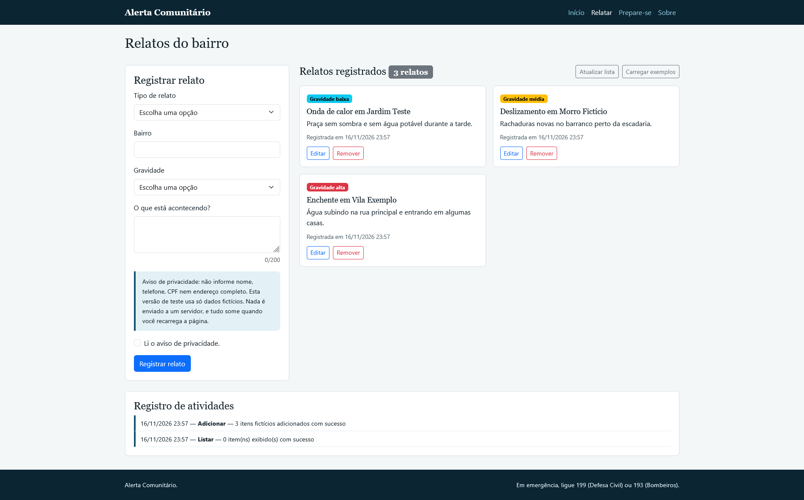
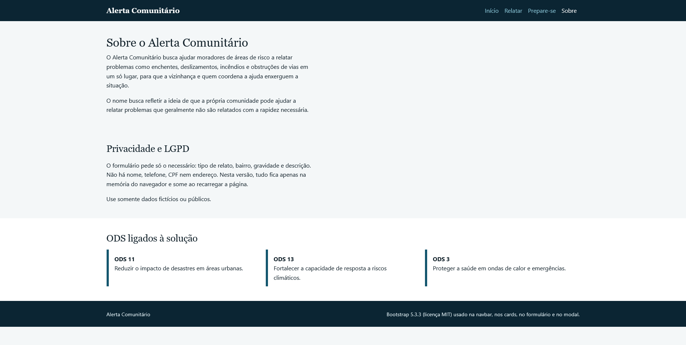

# Alerta Comunitário

O alerta comunitário tem como objetivo fornecer uma plataforma de comunicação onde cidadãos podem relatar desastres ou problemas estrututrais como: enchentes, deslizamentos, mudanças climáticas estremasa, obstruções de vias, etc.

-----------------------------------------------------------------------------------------------------------------------------------------

## Problema e cidadãos

O principal problema tem relação com a falta de informações claras e rapidas sobre problemas que afetam principalmente cidadãos de comunidades pequenas, isoladas ou em áreas de risco. Os alertas da Defesa Civíl servem para avisar sobre possiveis desastres maiores, mas não servem para relatar as comunidades sobre problemas isolados que as afetam diretamente, como risco de enchentes em uma região ou um deslizamento que acabou de acontecer em algum bairro.

-----------------------------------------------------------------------------------------------------------------------------------------

## Tecnologias

- CSS
- HTML
- BOOTSTRAP
- JAVASCRIPT
- GIT
- GITHUB

-----------------------------------------------------------------------------------------------------------------------------------------

## Modo de execução

Baixe ou clone este repositório, abra a pasta no VScode e use a extensão Live Server para rodar a pagina em um servidor com porta local. Alternativamente, abra a pasta pelo explorador de arquivos, entre na pasta "html" abra qualquer arquivo html no navegador.

-----------------------------------------------------------------------------------------------------------------------------------------

## Estrutura de pastas

P2_alerta_comunitario/
├── html/
|   ├── index.html          
|   ├── preparacao.html    
|   ├── relatar.html     
|   └──sobre.html          
├── css/
|   ├── index.css
|   ├── preparacao.css
|   ├── relatar.css
│   └── sobre.css      
├── js/
│   ├── dados.js        
│   ├── registro.js     
│   ├── relatar.js   
│   └── validacao.js  
└── docs/
    └── prints     

-----------------------------------------------------------------------------------------------------------------------------------------

## Prints

